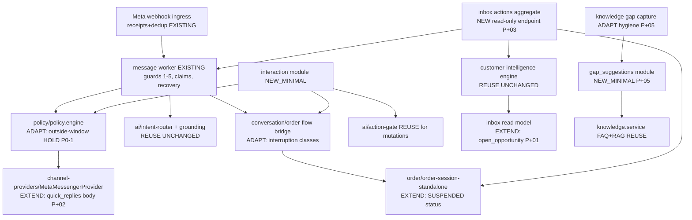

# Pilot+ V1 — 03. Architecture and Interaction Contracts (FROZEN for implementation)

Skills applied: architecture-designer + api-designer (provenance in 01) under the binding repository
contracts (CONTRIBUTING-AI.md four gates; api-contract-rules envelope — which supersedes generic
RFC7807 templates; tdd-rules order). Personas recorded dissent in §9.

## 1. Requirements summary

Functional: five workstreams P+01..P+05 (§0 master loop). Non-functional: no new infra; deterministic
state safety; per-shop flags default-off; mobile-first inbox usability; storefront-ready contracts;
measurable pilot (§16). Constraints: modular monolith, PostgreSQL, Redis/BullMQ, existing Message/
Conversation/delivery-state model, Action Gate, Product V1.3 grounding, opportunity detector, outbound
policy chain, Meta safe rules.

## 2. Architecture (unchanged topology; two new modules, two extended surfaces)



No new queues, services, event bus, or workflow DSL. New BullMQ repeatable jobs only where a sweeper is
required (opportunity-detector precedent): `knowledge_gap_suggester` (daily), interaction expiry is
READ-TIME computed (expires_at column) — no sweeper (simpler, race-free: resolver checks expiry).

## 3. Shared operational vocabulary (§5.2) — versioned constants, no new agent framework

| Concept | Physical carrier | Authority |
|---|---|---|
| Conversation intent | `intent.contract.js` INTENTS (21 active) + stage2-rules v1.1.0 | AI module |
| Interaction proposal | NEW `interaction/interaction-contract.js` v1: kinds + allowed operations registry | Interaction module |
| Customer decision | `customer_interactions` row transition + Message(inbound, metadata.quick_reply) | Interaction module |
| Business execution | order-flow bridge / processStep / handoff / grounded reply / Action Gate | existing engines |
| Customer outcome | Message delivery_state + Order/OrderSession rows | conversation/order modules |
| Merchant work item | deriveWorkflowProjection reasons + live opportunity/session/gap rows (read model) | P+03 aggregate |
| Knowledge improvement | `knowledge_gap_suggestions` row lifecycle | P+05 module |

Inbox NEVER computes a score (ADR-0006 upheld). LLM NEVER invents/executes actions: proposal option
titles/payloads come ONLY from the server-side registry per kind; classifier output selects a proposal
template, never generates one.

## 4. P+02 Interaction contract — the only genuinely new mechanism

### 4.1 Data model (additive migration `202610xx_001_pilotplus_interactions.js`)

`customer_interactions`: id UUID PK (opaque); shop_id FK CASCADE; customer_id FK; customer_channel_id +
meta_channel_id (channel-scoped identity, mirrors sessions); conversation_id FK; kind VARCHAR(40)
CHECK IN registry; bound_entity_type VARCHAR(30) NULL (order_session|conversation) + bound_entity_id +
bound_context_version VARCHAR(64) NULL (session step+summary-hash / resume boundary); options JSONB
[{option_id, operation_id, title}] (titles from registry, ≤20 chars after i18n); status
GENERATED|SENT|CONSUMED|SUPERSEDED|EXPIRED|VOID (CHECK); expires_at TIMESTAMPTZ NOT NULL; message_id
FK NULL (AI Message that carried it — SENT/failed/delivery truth DERIVED from that row, no duplicate
delivery states); resolution JSONB NULL {option_id, operation_id, outcome, resolved_at}; created_by
VARCHAR(40) (worker|controller); timestamps. Indexes: (shop_id,status), (conversation_id,status),
unique-partial live per (conversation_id,kind) WHERE status IN ('GENERATED','SENT') — supersession is
explicit, prevents racing proposals for the same kind.

Karpathy challenge answered: one row per PROPOSAL (not per element/visual); SENT/FAILED states are not
duplicated — they live on the linked Message.delivery_state (existing ADR-0004 truth); CONSUMED carries
audit. Persistent EXPIRED is not even written by a sweeper: resolver treats `expires_at < now` as
EXPIRED at decision time; display computes it. (§8.4 "only add persistent states when required".)

### 4.2 Payload security (opaque reference, not self-encoded claims)

quick_reply.payload = `p1:<interaction-id>:<option_id>`. Payload carries ZERO authority: resolver loads
the row by id with full tenant/customer/channel/conversation binding check. Tamper (any unknown id,
foreign option_id, wrong customer, wrong Page/channel, superseded/expired status, mismatched
bound_context_version) => REJECT, no business effect, metric+audit `INTERACTION_REJECTED{reason}`.
Idempotency: transition `SENT->CONSUMED` is a conditional UPDATE ... WHERE status='SENT' under
SELECT FOR UPDATE; second tap/concurrent webhooks get 0 rows => no-op (replay-safe). Expiration TTL:
clarify 30 min; checkout-bound 24 h aligned w/ session expires_at, and hard-capped by
bound_context_version (repriced summary => version mismatch => old confirm choice CANNOT create order;
must re-confirm — invariant §8.5).

### 4.3 Kinds and allowed operations (registry v1 — closed set)

| kind | when proposed (server rules, deterministic) | options (title ≤20ch; BN/Banglish/EN per language) | operation -> existing code path |
|---|---|---|---|
| CLARIFY_NEEDS | greeting/idle inbound, ≥2 unresolved question types, low-confidence SAFE_FALLBACK | Details / Delivery / Talk to a person | PRODUCT_INQUIRY answer branch / DELIVERY_POLICY+CHARGE answer / HUMAN handoff (no mutation) |
| CHECKOUT_DECISION | ORDER_SUMMARY reached; or resume after pause | Review again / Change something / Cancel checkout / (Confirm order — ONLY with summary hash bound) | re-render summary / processStep edit path / CANCEL_ORDER_SESSION via Gate / same code as typed confirm (extractConfirmation) |
| HUMAN_SUPPORT | HUMAN_HANDOFF_REQUEST/SENTIMENT detected; choice offered "A person will help — continue with AI?" | Wait for a person / Continue now | handoff create/pause; continue = ai:pause clear + resume boundary |
| CHECKOUT_RESUME | informational answer delivered mid-checkout | Continue order / Later | re-ask current step (ACTIVE|SUSPENDED) / explicit later = stays SUSPENDED |

Every operation executes by re-entering the SAME service call a typed equivalent would make
(text-equivalence principle: choice tap expresses intent; business state RELOADED; typed path stays the
superset). Mutations (confirm/cancel) pass the existing Action Gate incl. material-state revalidation +
confirmed_summary_hash; a tap cannot manufacture paid/stock/delivery facts (§8.3).

### 4.4 Transport + fallback (Meta Platform Specialist)

Verified current Meta facts (Oct 2026): quick_replies supported on Messenger Send API; ≤13 per message;
title ≤20 chars; payload ≤1000 chars; tapped quick reply arrives as ordinary `messages` webhook event
`message.quick_reply.payload` — already persisted by our ingress (handler L1079-83). Buttons/postback
(messaging_postbacks) NOT used in v1 (requires extra subscription; more surface). Buttons remain
clickable alongside free text; buttons dismiss on ANY typed reply (platform behavior) — free text
ALWAYS works (existing stage2 path unchanged). Unsupported/unknown channel or policy-blocked interactive
send => numbered-text fallback (same format the product picker already uses L301-312) with identical
operations ("reply 1/2/3"); resolver also accepts "1"/"2" free text ONLY inside a bound context where a
proposal row exists and is current (bounded, not a general number parser). Outbound policy chain
unchanged and applies (consent/window/opt-out/rate/sanitizer/business-hours).

### 4.5 Storefront adapter contract (binding interface, not built now)

`POST /api/interactions/{id}/resolve {option_id}` (session-auth, same tenant bindings, same resolver,
same idempotency) is the FUTURE storefront surface; implemented in the pilot behind the JWT-merchant-
only API? NO — customer-facing storefront auth does not exist yet, so contract is SPECIFIED + resolver
kernel is channel-parameterized (`resolve(interactionId, optionId, {channel:'messenger'|'storefront',
actorRef})`), with unit tests proving channel-agnostic core + a messenger adapter test. No storefront
route is mounted (scope control). Interaction rows already carry channel scope columns, so Messenger and
storefront identities can never merge (§5.3).

## 5. P+04 interruption classes (order-flow bridge v2)

New deterministic order in `handleOrderFlow` when session ACTIVE (stage2 classify() — zero new LLM cost):
1. negated-cancel / negated-purchase => ACK only (existing; add "na korte paro na" scope tests).
2. explicit ORDER_SESSION_CANCEL (non-negated, targets current session) => EXISTING cancel path + truthful result.
3. STOP_OPT_OUT => existing consent recording; session terminated per current rules (verified: stop = terminal, correct).
4. HUMAN_HANDOFF_REQUEST / SENTIMENT_HANDOFF => SUSPEND session (new status), preserve step_data,
   create/refresh ONE handoff (conversation.hitl=true + reason), release turn to normal pipeline for the
   support acknowledgment; NO cancel (F2 fix).
5. ORDER_STATUS_LOOKUP / ORDER_POST_PURCHASE_REQUEST (about a DIFFERENT order) => answer via existing
   read-action/lookup path (fail-closed identity), session SUSPENDED while answered, deterministic resume
   prompt follows.
6. INFORMATIONAL (DELIVERY_POLICY/DELIVERY_CHARGE/PAYMENT_POLICY/PAYMENT_METHODS/PRODUCT_*/FAQ_KNOWLEDGE_QUESTION)
   => release turn to grounded pipeline (answers only from allowed evidence: delivery = enabled settings/
   knowledge; payment = enabled methods via P0-3 adapter; product = V1.3 grounding); NEVER writes
   step_data; then CHECKOUT_RESUME proposal (§4.3) or deterministic re-ask.
7. belt inside step machine: capture steps (NAME/ADDRESS/PHONE/ZONE/NOTES/QUANTITY) reject
   question-shaped input (`\?|ki\?|koto|kemon|কত|কেমন|কা[^অ]?` minimal + classify==informational) =>
   return step unchanged with answer-route signal (V-3 defense; zero model calls).
8. Everything else => processStep exactly as today (typed answers, numbers, names still work).

Resume: any new inbound from same customer+channel scope with session SUSPENDED re-enters the machine at
the preserved step; merchant resolving the handoff sets existing ai_resume_boundary_at + reactivates
SUSPENDED sessions for that conversation (durable across worker restart — all in DB). Migration:
order_sessions.status ENUM + 'SUSPENDED' (additive, reversible). Tests LOCKING old cancel behavior
(order-flow.service.test.js L136-153) are rewritten as the intentional behavior change with evidence
recorded in doc 06.

## 6. P+01 projection + P+03 aggregate (read models — no second truth)

P+01: extend conversation list/detail payload in `conversation.service` with `open_opportunity`
{opportunity_id, strength, reasons[], status, recommended_action, contactable, handled: false} via one
LEFT JOIN to live CustomerOpportunity rows (shop-scoped, flag-gated; null when pilot off). Frontend
chips + strip; contacted/dismiss call EXISTING /api/customer-intelligence endpoints (audited, 409-safe).
Status consistency: server-authoritative everywhere; no client mutation beyond optimistic UI rollback.

P+03: `GET /api/inbox/actions` — pure request-time UNION-ALL read model over existing authorities:
bucket 1 needs-human (hitl=true with handoff reason), 2 committed-without-ack (messages with
executed_mutation_without_outbound_send / delivery_state FAILED|INDETERMINATE on business messages),
3 customer-blocked (SUSPENDED sessions or ACTIVE sessions quiet > 15 min, order_sessions), 4 draft/
held recovery (VISIBLE_DRAFT_REVIEW|VISIBLE_HITL_REVIEW suggestions + HELD reasons), 5 qualified
opportunities OPEN (flag-gated), 6 published knowledge suggestions OPEN (flag-gated, P+05). Each item:
{reason_code (existing vocab), source{type,id}, conversation_id, status snapshot, owner (assignee_id
when present), next_action descriptor, grounded_deadline (session expiry / window close) only where
fact-backed}. Deterministic rank within bucket = oldest-first attention age. Stale-proof by construction
(no persisted tasks). SSE: existing events already invalidate; FE refetch on hitl_changed/
message_delivery_updated/delivery_failed/conversation_updated. Mobile `/api/mobile/attention` (M-008)
remains separate; shared ranking constants extracted to `modules/inbox/action-reasons.js` (single
vocabulary) — mobile adapter may later consume; no behavior change to mobile now.
Human handoff (§9.4): existing HITL record IS the case (fields suffice: request, pause (guard 2),
visibility (projection), claim (assignee_id via existing take-over), resolution (resolved_at/
resolution_note + resume boundary). EXTEND only: (a) handoff reason + source message id recorded on
take-over and on automatic escalation (small metadata), (b) claim endpoint enforcing one-owner (second
merchant take-over => explicit 409 unless owner resolves; current toggle re-audited), (c) resolution
re-arms automation ONLY via existing resume-boundary stamping (never because a notification fired).

## 7. P+05 suggestion lifecycle

Migration `knowledge_gap_suggestions`: id; shop_id; norm_question VARCHAR(200) (deterministic
normalize: lowercase, whitespace-collapse, punctuation-strip, ≤150 chars — reuses listGaps
normalization); owner_domain CHECK(PAYMENT|DELIVERY|PRODUCT|POLICY|OTHER) (deterministic keyword
classifier from existing intent vocab); status CHECK(OPEN|IN_REVIEW|PUBLISHED|DISMISSED);
evidence_count INT; first_seen_at/last_seen_at; last_evidence_cursor (max knowledge_gaps.id at
resolution — dismissal cursor: re-OPENS only when NEW rows with id>cursor appear; satisfies §11.4);
sample_ref_ids JSONB (ids only, NEVER raw text — hygiene); resolved_faq_id FK NULL; timestamps.
Partial unique live per (shop_id, norm_question) WHERE status IN ('OPEN','IN_REVIEW'). Suggester job
(daily, per flagged shop, deterministic group-by on knowledge_gaps since cursor) upserts OPEN rows.
Merchant flow in FaqSettings.tsx: list OPEN/IN_REVIEW -> review sample questions (via existing gap read
by ids) -> author answer (FAQ draft = is_active=false) -> APPROVE publishes via existing FAQ create +
RAG sync + snapshot invalidation (no new publish path) -> row PUBLISHED + resolved_faq_id; DISMISS w/
reason -> cursor set. owner_domain structured (PAYMENT/DELIVERY/PRODUCT) surfaces a "Go to settings"
link action instead of FAQ authoring (authority preference §11.2; FAQ prose still allowed for policy).
Truth priority invariant: outbound grounding gate validates payment/delivery claims against ENABLED
config regardless of FAQ text (existing; asserted by new test).
Capture hygiene commit: recordKnowledgeGap single-utterance + phone/TrxID regex redaction
(`\d{11}|01[3-9]\d{8}|trxid[: ]?\w+` -> `[masked]`), burst rows keep only last message question.

## 8. Phase-3 prerequisite safety commits (isolated, reviewable, ordered before feature code)

1. `fix(policy)`: outside-window sends HOLD instead of blind retired/unsupported tagging; ALLOWED_TAGS
   reduced to {} for automated sends (HUMAN_AGENT only for human-role sends AND only when permission is
   proven by configuration flag default-off); rules tests updated incl. zero-retired-tag wire assertion
   on fake Graph transport. (P0-1; decision-doc + Meta 2026 evidence cited.)
2. `fix(payment-truth)`: neutralize dead OCR-"confirmed" branch + unreachable screenshot transition;
   invariant test "no payment-confirmation language without gateway/merchant verification". (P0-2.)
3. `fix(payment-authority)`: AI operating-context payment methods sourced from PaymentConfig enabled
   set (adapter fn), fail-closed; disable/delete sync shop.settings.bd consistency. (P0-3.)
4. `fix(order-status-truth)`: enforceStateConsistency no longer clobbers the live 'confirmed'
   vocabulary used across validators/FE/webhooks (evidence-driven list; F3); regression:
   createOrderFromSession order keeps 'confirmed'.
5. `docs(repo-hygiene)`: correct stale `.easymod` retired-tag guidance (meta-safe-rules L19-23,
   meta-policy-skill L49-58) pointing to Meta 2026 retirement + this doc set.

All preserve Manual/Draft/Auto semantics; NO grounding protection weakened; each ships failing-test-first.

## 9. Decision records (§17.2 condensed; full challenge logs in this folder's raw notes)

- DEC D1 Interaction storage = server rows w/ opaque refs. Alt: HMAC self-encoded payload. REJECTED for
  payload-authority: self-encoded claims can't enforce single-use/concurrency/reload cheaply; repository
  already persists authoritative rows (FlowGuard dissent filed: row per proposal acceptable because
  proposals are business facts subject to audit; momentumUX ok; Karpathy: no per-element rows).
- DEC D2 quick_replies only (no buttons/postback). BazarLens: merchants run Live — taps beat typing on
  phones; FieldFounder: smallest surface; Meta specialist: postback needs extra subscription, quick
  reply already ingressed.
- DEC D3 Bridge classification reuses stage2-rules (local, deterministic). REJECTED: LLM per-turn
  reclassification (cost + nondeterminism); shadow classification precedent exists.
- DEC D4 P+03 request-time aggregate over persisted task table. The-Fool challenge: "queue items that
  vanish when source changes = lie less"; a task DB would create stale-truth class §9.2 forbids.
  Alt (mobile M-008 /api/mobile/attention) kept separate to avoid cross-agent contract fight; shared
  reason vocabulary module prevents drift. REJECTED: generic tasks table.
- DEC D5 outside-window = HOLD (not tag) because Meta returns error 100 for remaining auto tags and
  HUMAN_AGENT requires ungranted permission + excludes automation; merchants recover via queue bucket 2/4.
  Utility-template migration = DEFER (future, needs App Review decision).
- DEC D6 P+05 deterministic normalization only; NO embedding clustering in v1 (quality bar unmet;
  FieldFounder cost; REJECT model assistance until measured need).
- DEC D7 F3 fix scope: coercion list only (not order-system rewrite). Why-not-simpler: leaving it means
  P+04 "committed order" surfaces false 'draft' state to merchants — violates Orders truth requirement.
- DEC D8 flags: reuse shop_pilot_features with new columns
  `interaction_choices`, `action_queue`, `knowledge_suggestions` (customer_intelligence already gates
  P+01). All default FALSE; SUPER_ADMIN-controlled (ADR-0009 pattern); no silent auto-outreach (spec §16).

## 10. Dependency graph (implementation order)

```
[Phase3 commits 1-5] ──┬─> [P+04 bridge+session] ──> [P+02 interactions (binds to resumed/suspended ctx)]
                       ├─> [P+01 backend projection] ─> [P+01 FE]
                       ├─> [P+03 aggregate + handoff extend] ─> [P+03 FE]
                       └─> [P+05 capture hygiene + module] ─> [P+05 FE] ─> (queue bucket 6 live)
Phase9 unified FE polish (all streams) -> Phase10 gates -> freeze SHA -> Phase11 verifier -> Phase12 handoff
```
Parallelization rule honored: backend P+01, P+03-agg, P+05-module, and Phase3 commits have disjoint file
ownership; FE files (UnifiedInbox family) serialized under Phase 9 to avoid intra-branch races.

## 11. Acceptance contracts (per workstream; each maps to named tests in doc 07)

P+01 AC1-AC9 == §7.4 (appear-once, single-question-not-high, negation/STOP suppress, authoritative
contact/dismiss, real-order conversion only, concurrency, Inbox==360, expired-permission no follow-up
offer, detector mode-independent).
P+02 AC1-AC12 == §8.5 (exactly-once, replay, forge, cross-customer/shop/channel, expired/superseded,
stale-summary, multi-tap, fallback, typed equivalence, mobile render, no premature success claim).
P+03 AC1-AC10 == §9.5 (one item per request, webhook idempotence, refresh+restart survival, owner
conflict 409, server-side roles, disappear-after-resolution, SSE+reload convergence, cross-shop
isolation, AI-resume-only-by-boundary, held message recoverable).
P+04 AC1-AC14 == §10.4 matrix (question-during-each-step keeps fields; support= pause+handoff+cart
kept; existing-order lookup; explicit cancel once; negated cancel; duplicate/out-of-order messages;
delayed reply; worker restart; stale/expired choice; concurrency; reprice => new confirmation;
enabled-payment revalidation; stock revalidation; ordinary question never becomes field value).
P+05 AC1-AC9 == §11.4 (single useful suggestion for duplicates, approve->publish->retrieval, dismiss
w/ cursor, no unapproved to customer, config truth > FAQ, multi-shop isolation, PII hygiene,
answerability measurement hook).
Invariants (§14) each get one executable test touching the real implementation; payment-confirmation,
screenshot, courier-requested, handoff-requested, suggestion-generated, response-delivered pairs all
covered by the AC sets + Phase-3 commit tests.

## 12. Rollback strategy (per phase)

Every migration additive: `customer_interactions` (drop table), `order_sessions` status value (drop value
revert check constraint), `knowledge_gap_suggestions` (drop), `shop_pilot_features` columns (drop
defaults false), delivery-state untouched. Phase-3 rule changes revert by git revert (no data touched);
F3 list change data-neutral (rows already 'confirmed'-coerced get corrected by their own next touch OR
documented one-off script — NOT run without authorization; see doc 06). Feature code all flag-gated;
rollback = flag off (SUPER_ADMIN disableAll kill switch precedent) + revert commit. No destructive
migration in the entire Pilot+ change set.
